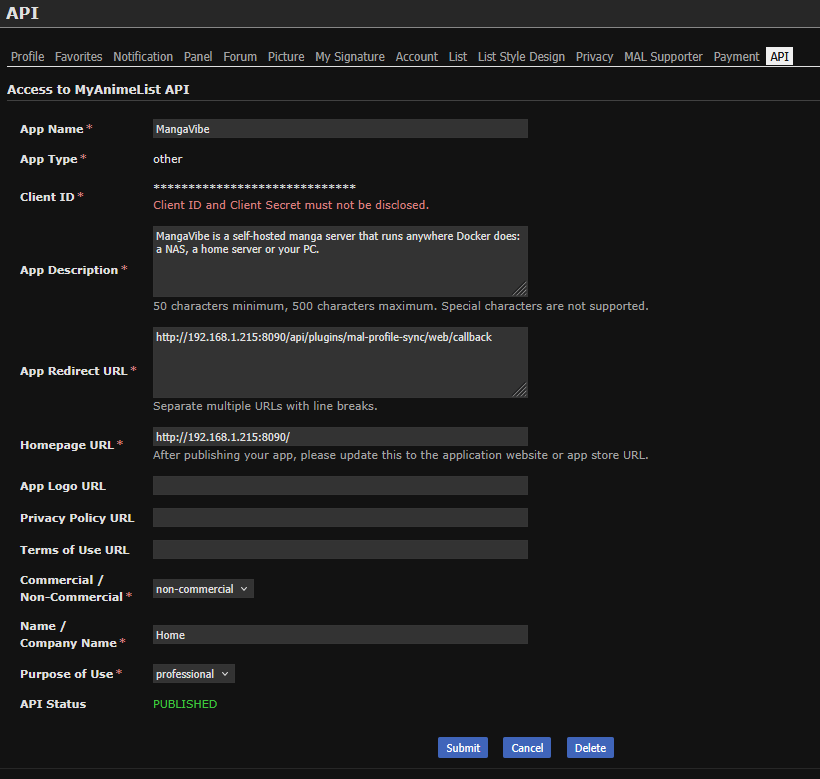

# MyAnimeList sync for MangaVibe

A [MangaVibe](https://github.com/ivokolarov0/manga-vibe) plugin that keeps your MyAnimeList manga list
in step with what you read. It only syncs the **status** (Reading / Completed / Dropped), not chapter counts.

## Automatic or Manual

**Settings → Plugins → MyAnimeList sync → Sync** decides whether MangaVibe changes your MyAnimeList list
by itself:

**Automatic** (the default):

| You… | MyAnimeList gets |
|---|---|
| start reading a series | **Reading** |
| finish the last book you have, and the series has **ended** | **Completed** |
| finish the last book you have, and the series is **still coming out** | stays **Reading** |
| set a series to Completed by hand | **Completed** |
| set a series to Dropped by hand | **Dropped** (even if it was Completed there) |
| reset a series (mark it all unread, or clear its status) | **removed** from your list |

**Manual:** nothing is sent by itself. You change MyAnimeList yourself with the dropdown on the series
page (below), or with the sync buttons.

**Sync all** (Settings → Plugins) and **Sync with MyAnimeList** (series page, Plugin tools) also go the
other way:

- Completed on MyAnimeList → **Completed** in MangaVibe (no matter which chapters you've read)
- Reading on MyAnimeList → **Reading** in MangaVibe, if you hadn't started it there
- Dropped on MyAnimeList → **Dropped** in MangaVibe
- anything you're reading or finished in MangaVibe that MyAnimeList doesn't have yet is sent there

The sync never sets a series that's Completed on MyAnimeList back to Reading by itself, and it never
changes On hold or Plan to read by itself.

## Change the status from MangaVibe

The series page has a **MyAnimeList** dropdown under the reading status. It shows the series' status
on MyAnimeList, and you can change it there instead of on the website:

| You pick… | MyAnimeList | MangaVibe |
|---|---|---|
| **Reading**, **Completed**, **On hold**, **Dropped** or **Plan to read** | set to that | set to the same status |
| **Not on my list** | removed from your list | stays as it is |

A series you removed stays off your list: **Sync all** won't send it back. It goes back on MyAnimeList
only when you change its status in MangaVibe yourself, or pick a status in the dropdown.

The dropdown shows what the plugin last saw on MyAnimeList. If you changed something on the website,
press **Sync with MyAnimeList** (Plugin tools) or **Sync all** to update it. *Unknown* means the series
hasn't been synced yet.

Series need a MyAnimeList id. They get one when they're matched through AniList (most are). Series
without one have no dropdown and are skipped by the sync; the last sync result in Settings says how many.

The dropdown and the Sync setting need **MangaVibe 1.2.0** or newer. On older versions the plugin
loads and syncs automatically as before, without them.

## Install

1. Download [`mal_profile_sync.py`](mal_profile_sync.py) (open it on GitHub → **Download raw file**).
2. Put it in the `plugins` folder of MangaVibe's data folder (`docker-data/plugins` next to your
   `docker-compose.yml`, or `docker/mangavibe/plugins` on a Synology).
3. In MangaVibe: **Settings → Plugins → Reload plugins**. *MyAnimeList sync* appears in the list.

**Updating:** on MangaVibe 1.2.0 or newer, *MyAnimeList sync* has an **Updates** row in
**Settings → Plugins**. When a new version is out, it shows **Update to vX** and **Skip this
version**; nothing is installed until you press Update. Your login and settings are kept. On older
MangaVibe versions, replace the file and press **Reload plugins**.

The plugin lists what it uses (**Uses:** under it in Settings → Plugins). On MangaVibe versions
that support this, an update that adds a permission lists it and installs only after you agree.

To remove it, delete the file.

### Publishing a new version (for the maintainer)

1. Raise `version` in `mal_profile_sync.py` and merge it.
2. Create a GitHub release with the tag `v<version>`, e.g. `v1.1.0`. MangaVibe only offers
   published releases, not drafts or pre-releases, and downloads `mal_profile_sync.py` at that tag.

## Connect your MyAnimeList account

1. Open MangaVibe's **Settings → Plugins**. Under *MyAnimeList sync* it shows the **redirect URL**:
   `http://{{YOUR_IP_ADDRESS_HERE}}:8090/api/plugins/mal-profile-sync/web/callback`, with your NAS's
   address in place of `{{YOUR_IP_ADDRESS_HERE}}`. It's built from the address you opened MangaVibe
   at, so open it the way you normally do, and copy it from there rather than typing it.
2. Go to <https://myanimelist.net/apiconfig> → **Create ID** and fill in:
   - **App Type:** `other`
   - **App Redirect URL:** the redirect URL from step 1, exactly (same address, port, no `/` at the end).
     If it doesn't match, MyAnimeList sends you back to its login page over and over after you
     allow access.
   - the other fields (name, description, homepage…) can be anything

   
3. Copy the **Client ID** into the *Client ID* box in MangaVibe. It's hidden like a password once
   saved. (Leave *Client secret* empty. It's only needed if you picked App Type `web`.)
4. Press **Connect MyAnimeList**, log in on MyAnimeList and allow access. You land back on a page that
   says "Connected". Settings now shows *Connected as &lt;your name&gt;*.
5. Press **Sync all** once to bring both sides in line.

The login renews itself. You only connect again if you press Disconnect or don't use MangaVibe for
a few months.

**If your NAS gets a new IP address**, syncing keeps working. Only a new **Connect** needs the redirect
URL on MyAnimeList to match. Give the NAS a fixed address in your router (*DHCP reservation*) and
you won't have to think about it.

## Development

Tests run against a MangaVibe checkout, by default `../../manga-vibe` (set `MANGAVIBE_DIR` otherwise),
with a fake MyAnimeList:

```
pip install -r ../../manga-vibe/requirements-dev.txt
python -m pytest
```
